<p align="center">
  <picture>
    <source media="(prefers-color-scheme: dark)" srcset="icon-512.png">
    <source media="(prefers-color-scheme: light)" srcset="icon-512-light.png">
    
  </picture>
</p>

<h1 align="center">Twig</h1>

<p align="center"><b>Twig — AI Git client for macOS, Windows, Linux, ChromeOS and FreeBSD</b></p>

<p align="center">
  Version <b>1.0.3</b> · released 12 Oct 2026 ·
  <a href="https://github.com/JKS-sys/twig-08-oct-2026-releases/releases/latest">Download</a> ·
  <a href="https://ipconfig.co.network/twig">Website</a> ·
  <a href="RELEASE-NOTES.md">Release notes</a>
</p>

<p align="center">
  &nbsp;&nbsp;
  
</p>

Twig is an AI Git client — a native desktop app of a few megabytes. It runs the real `git` you already
have, so everything it does is ordinary Git — nothing to migrate, nothing hidden.

## AI

- **Twig AI, built in and free for everyone** — no account, no key, nothing to set up
- **GitHub Copilot CLI and GitHub Models** — use the AI you already have with GitHub
- **Every local AI** — Ollama, LM Studio, llama.cpp, Jan, GPT4All, LocalAI, vLLM, KoboldCpp,
  text-generation-webui and llamafile, all on your own machine
- **Online AI services** — any provider, by URL and API key
- **Writes commit messages and descriptions** from your staged changes
- **Explains every git command** Twig runs, in plain words
- **A chat box and a suggestion box** — ask about your repository, or take the next step it suggests

## Features

- **Publish anywhere — public or private** — GitHub, GitLab, Bitbucket, Codeberg, Gitea, Forgejo, Azure DevOps,
  SourceForge and Radicle: Twig creates the repository, adds the remote and pushes, in one step
- **Accounts** — sign in once with a token (or your GitHub CLI sign-in); push and pull to every host with no extra setup
- **New repository** — README, a .gitignore for your language, a licence, the default branch, and publish right away
- **Clone from your accounts** — pick from your own repositories instead of pasting URLs
- **View on the web and pull requests** — open a branch or commit on its host, or start a pull / merge request
- **Several windows** — New Window, Open in New Window; closing the last tab or window quits Twig
- **Right-click in the Finder, File Explorer and Linux file managers** — Open in Twig, Show History, Blame
- **Right-click everywhere in Twig** and a **Dock menu** on macOS, with submenus and keyboard navigation
- **Fits any window** — from 480 × 320 up, nothing overlaps and the window never scrolls
- **Worktrees, co-authors, signed commits, patches, ZIP export, clean and optimize**
- **Colour with meaning, never pink** — brackets by depth, operators, types and git commands each in their own colour
- **Vector animations with sound** — every action draws its own little picture (lively, subtle or off)
- **Commit graph** — branches and merges drawn as lanes, with search by message and author
- **Hunk & line staging** — stage or discard a whole file, one hunk, or single lines
- **Branches, tags and remotes** — create, rename, check out, delete, fetch, pull, push
- **Stash manager** — save, apply, pop, preview and drop stashes
- **Interactive rebase** — reorder, squash, fixup, reword and drop commits
- **Cherry-pick, revert and reset** — soft, mixed or hard, from any commit in the graph
- **Blame & file history** — who changed each line, and every version of a file
- **Conflict resolver** — ours / theirs / both per conflict, then mark resolved
- **Insights** — a contribution heatmap and per-author activity
- **Clone and init** — start from a URL or an empty folder
- **Multi-repo tabs** — keep several repositories open side by side
- **Command palette** — every action from the keyboard
- **Synthesized sound effects** — over 60 tiny Web Audio cues in six sound packs, one toggle to mute
- **Animations** — short, calm motion that respects “reduce motion”
- **Light and dark themes** — follows the system or your choice

<!-- media:start — written by scripts/readme-media.mjs; edit the lists there -->
## See it in action

### Start-up

The twig draws itself, its leaves open and sparks fly while “An AI Git client” types out — with its own sound. Any key skips it; Settings → Startup turns it off.

<a href="docs/demos/startup.mp4"></a>

<sub>▶ Sharper and with smooth motion: <a href="docs/demos/startup.mp4">startup.mp4</a></sub>

### AI writes the commit message

Write message streams a summary and description from your staged changes. Commit, and the leaves burst, a little drawing pops up and a streak fanfare plays for your first commit of the day.

<a href="docs/demos/ai-commit.mp4">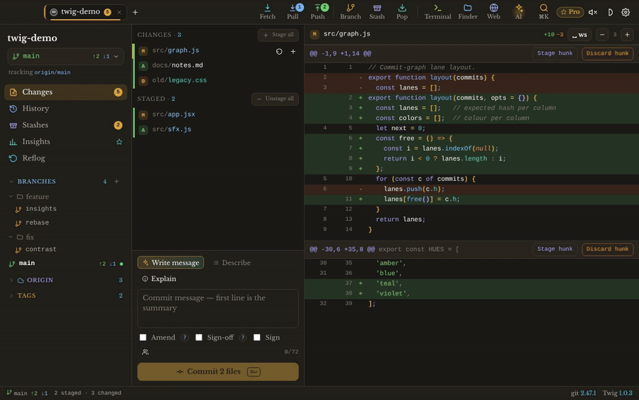</a>

<sub>▶ Sharper and with smooth motion: <a href="docs/demos/ai-commit.mp4">ai-commit.mp4</a></sub>

### Publish — public or private

A folder with no remote: Publish creates the repository on GitHub, GitLab, Bitbucket, Codeberg, Gitea, Forgejo, Azure DevOps, SourceForge or Radicle, adds the remote and pushes — three steps you can watch.

<a href="docs/demos/publish.mp4">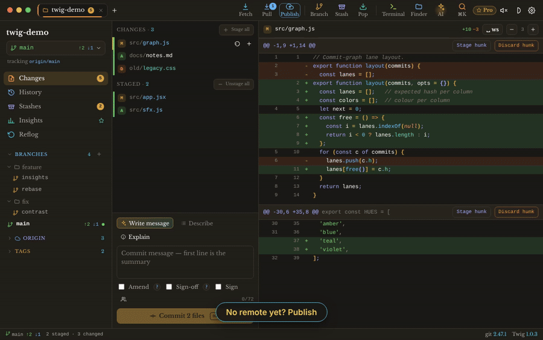</a>

<sub>▶ Sharper and with smooth motion: <a href="docs/demos/publish.mp4">publish.mp4</a></sub>

### History, colours and commit menus

The commit graph with lanes, coloured commit types (feat, fix, docs…), tags and branches. Right-click a commit for Copy, Export (patch or ZIP), cherry-pick, revert and its page on the host.

<a href="docs/demos/history.mp4">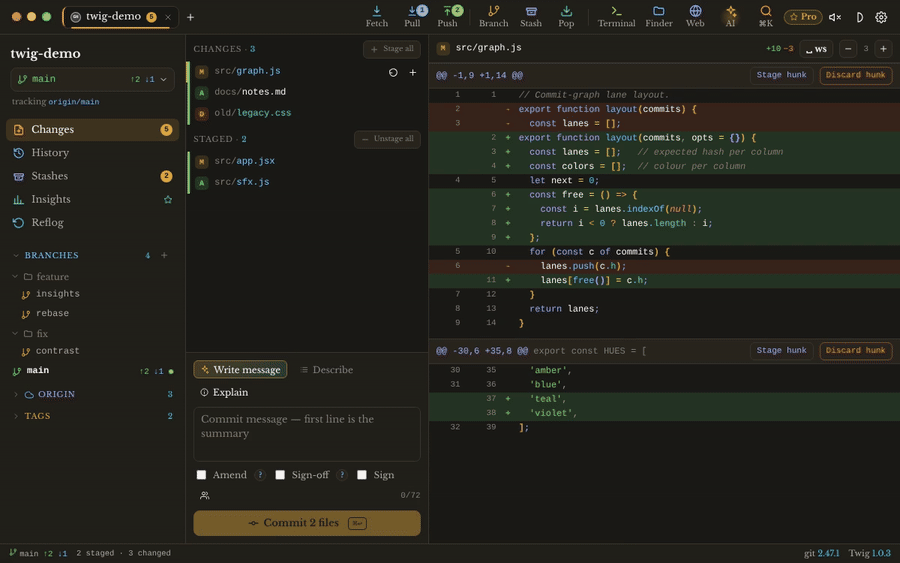</a>

<sub>▶ Sharper and with smooth motion: <a href="docs/demos/history.mp4">history.mp4</a></sub>

### Right-click everywhere

Every toolbar button has its own menu (pull with rebase, push tags, force with lease), tabs have Copy and Close submenus, and the title bar holds theme, animations, sounds and text size.

<a href="docs/demos/menus.mp4"></a>

<sub>▶ Sharper and with smooth motion: <a href="docs/demos/menus.mp4">menus.mp4</a></sub>

### Fits any window

Shrink the window to 480 × 320: toolbar buttons fold into ⋯, the sidebar slides over the page from Menu, and nothing overlaps or scrolls.

<a href="docs/demos/small-window.mp4">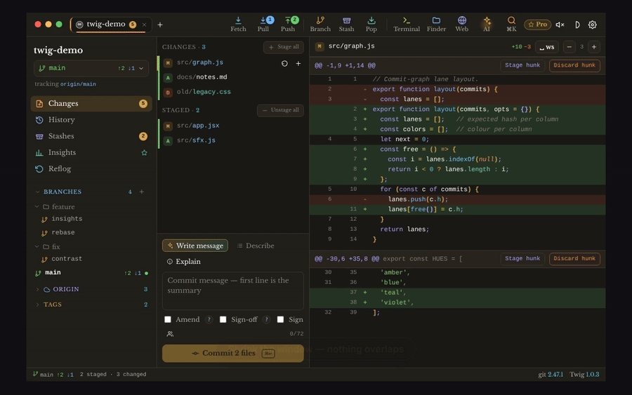</a>

<sub>▶ Sharper and with smooth motion: <a href="docs/demos/small-window.mp4">small-window.mp4</a></sub>

### Ask Twig AI

Chat about your repository. Answers colour every part of a git command, and commands get a Run button — risky ones ask twice.

<a href="docs/demos/ai-chat.mp4">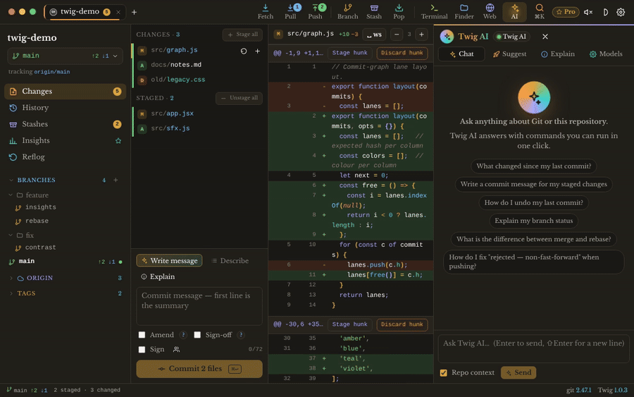</a>

<sub>▶ Sharper and with smooth motion: <a href="docs/demos/ai-chat.mp4">ai-chat.mp4</a></sub>

## Screenshots

Click any picture for the full-resolution (2×) version.

<table>
<tr><td width="50%" valign="top"><a href="docs/screenshots/welcome.webp">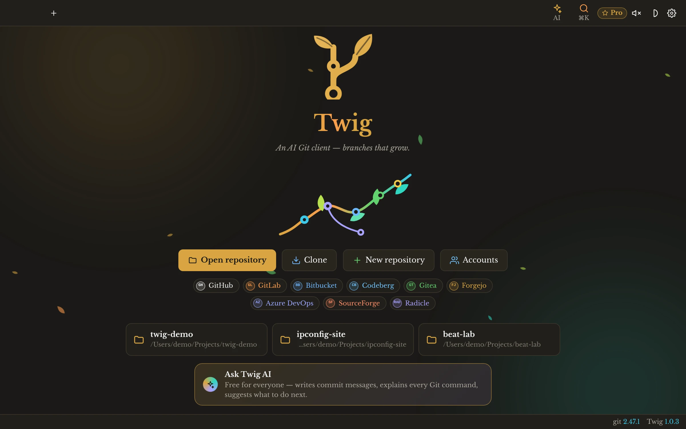</a><br><sub>Start screen — open, clone or create a repository, or add a GitHub, GitLab, Bitbucket, Codeberg… account</sub></td><td width="50%" valign="top"><a href="docs/screenshots/changes.webp">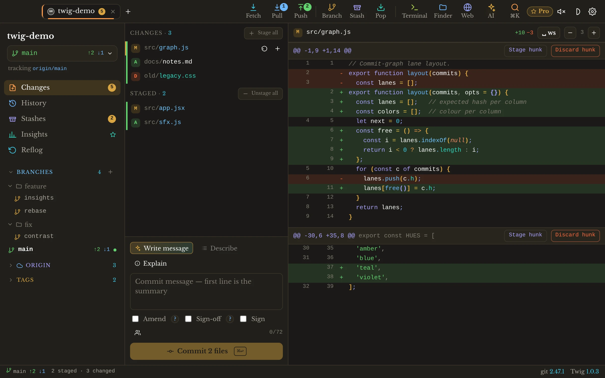</a><br><sub>Changes — stage files, hunks or single lines; code coloured by meaning, brackets by depth</sub></td></tr>
<tr><td width="50%" valign="top"><a href="docs/screenshots/changes-light.webp">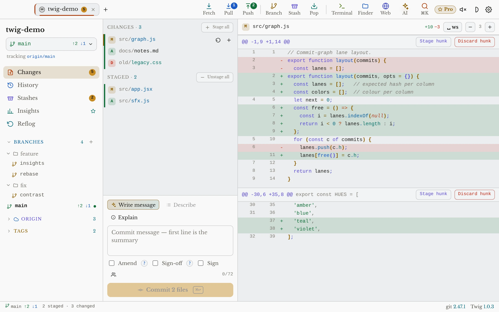</a><br><sub>The same in the light theme</sub></td><td width="50%" valign="top"><a href="docs/screenshots/history.webp">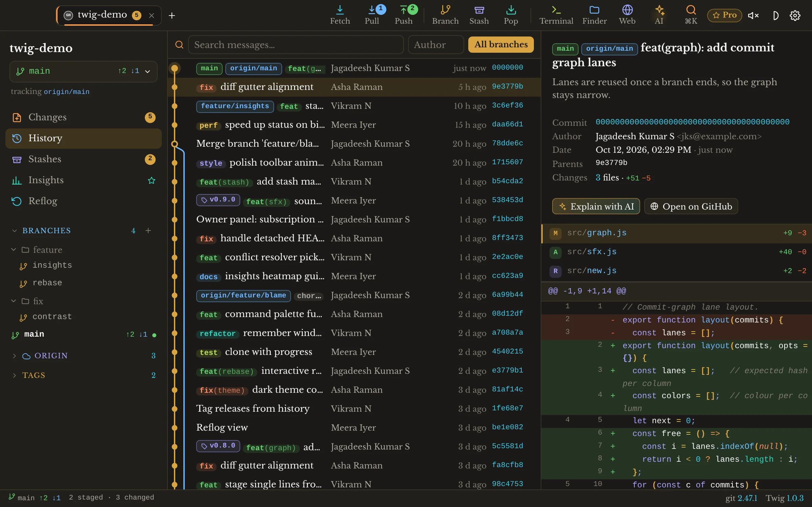</a><br><sub>History — branch lanes, tags and coloured commit types</sub></td></tr>
<tr><td width="50%" valign="top"><a href="docs/screenshots/publish.webp">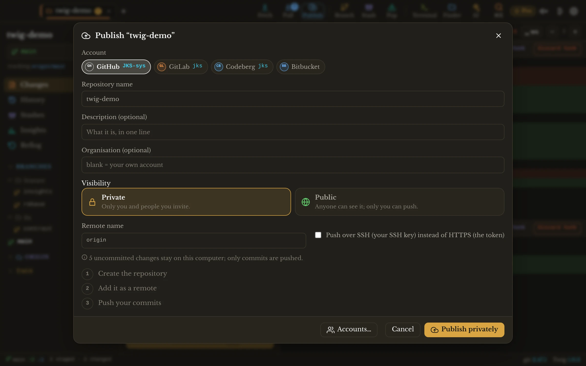</a><br><sub>Publish — create a public or private repository and push, in one step</sub></td><td width="50%" valign="top"><a href="docs/screenshots/accounts.webp">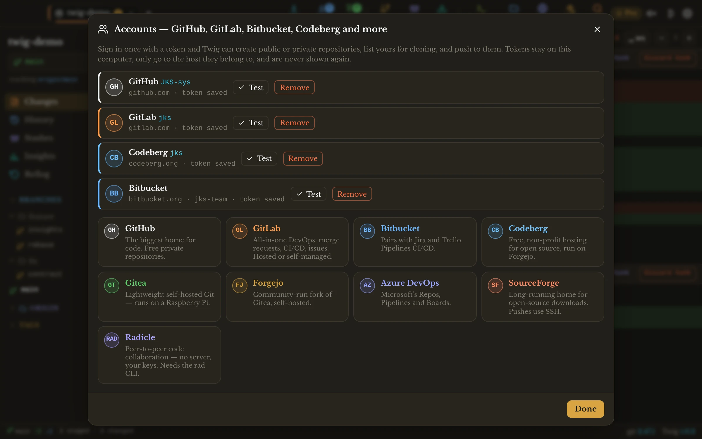</a><br><sub>Accounts — nine code hosts, a token or your GitHub CLI sign-in</sub></td></tr>
<tr><td width="50%" valign="top"><a href="docs/screenshots/worktrees.webp">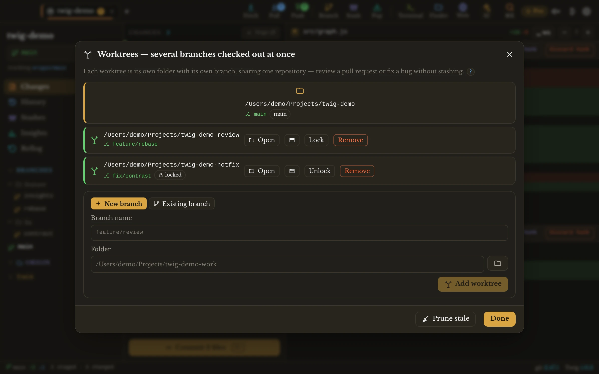</a><br><sub>Worktrees — several branches checked out at once</sub></td><td width="50%" valign="top"><a href="docs/screenshots/ai.webp">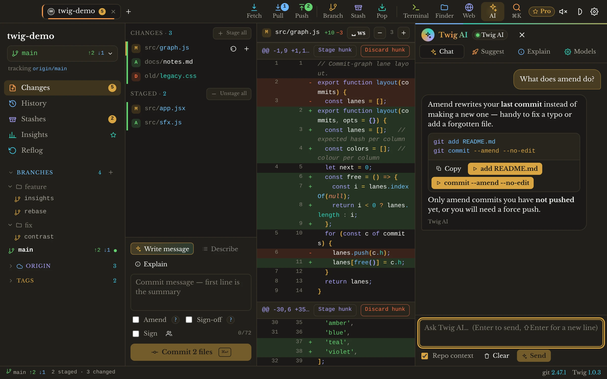</a><br><sub>Twig AI — chat, suggestions and explanations, free for everyone</sub></td></tr>
<tr><td width="50%" valign="top"><a href="docs/screenshots/small.webp">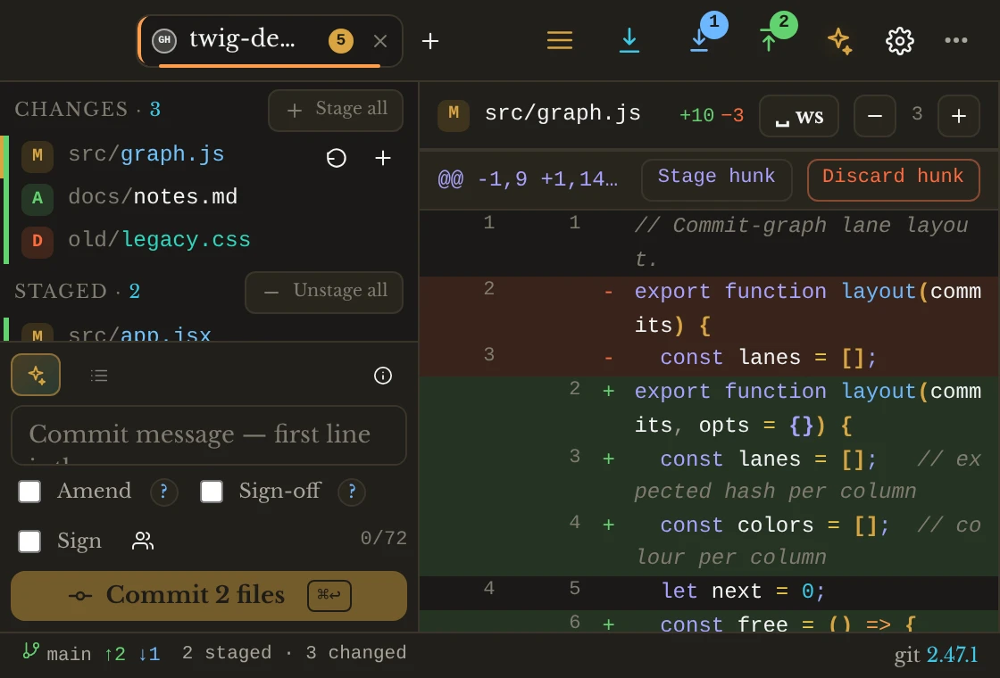</a><br><sub>A 560 × 380 window — every control still fits</sub></td></tr>
</table>
<!-- media:end -->

## Install

**macOS** (Apple silicon and Intel) — Terminal:

```bash
curl -fsSL https://ipconfig.co.network/updates/twig/install.sh | bash
```

The installer picks the right build, copies **Twig.app** to `/Applications` and clears the quarantine flag.
If you install from the DMG by hand instead, run this once before the first launch:

```bash
xattr -cr /Applications/Twig.app
```

**Windows** — PowerShell:

```powershell
irm https://ipconfig.co.network/updates/twig/install.ps1 | iex
```

SmartScreen may warn on first launch: *More info → Run anyway*.

The same command installs the **ARM64** build on Windows on Arm (Snapdragon / Surface Pro X and similar) —
or download `Twig_1.0.3_arm64-setup.exe` from the [latest release](https://github.com/JKS-sys/twig-08-oct-2026-releases/releases/latest).

**Linux** (x86_64)

- AppImage: `curl -fsSL https://ipconfig.co.network/updates/twig/install.sh | bash` — installs to `~/.local/bin/twig`.
  Or download `Twig_1.0.3_amd64.AppImage` from the [latest release](https://github.com/JKS-sys/twig-08-oct-2026-releases/releases/latest),
  then `chmod +x Twig_*.AppImage && ./Twig_*.AppImage` (needs `libfuse2`).
- Debian / Ubuntu: `curl -fsSL https://ipconfig.co.network/updates/twig/install.sh | bash -s -- --deb`,
  or download `Twig_1.0.3_amd64.deb` and `sudo apt install ./Twig_1.0.3_amd64.deb`.

**Linux ARM64** (Raspberry Pi 4/5 with a 64-bit OS, ARM laptops and servers) — Debian / Ubuntu:

```bash
curl -fsSL https://ipconfig.co.network/updates/twig/install.sh | bash
```

or download `Twig_1.0.3_arm64.deb` and `sudo apt install ./Twig_1.0.3_arm64.deb`.
ARM64 Linux has a .deb only — there is no ARM AppImage.

**ChromeOS** — Twig runs in the Linux development environment (a Debian container), on Intel/AMD and ARM Chromebooks:

1. **Settings → Advanced → Developers → Linux development environment → Turn on** (a few minutes the first time).
2. Open the **Terminal** app and run the installer — it picks the right package for your Chromebook:
   ```bash
   curl -fsSL https://ipconfig.co.network/updates/twig/install.sh | bash
   ```
   Or by hand: `dpkg --print-architecture` says `amd64` (Intel/AMD) or `arm64` (ARM). Download
   `Twig_1.0.3_amd64.deb` or `Twig_1.0.3_arm64.deb`, move it to **Linux files**, then double-click it —
   or run `sudo apt install ./Twig_1.0.3_<arch>.deb`.
3. Install Git in the container: `sudo apt install git`.
4. Open Twig from the launcher (**Linux apps**). Your repositories live in **Linux files**; share other
   folders with Linux from the Files app (right-click → *Share with Linux*).

**FreeBSD** (amd64, FreeBSD 14 or later, with a desktop) — as root:

```sh
pkg install webkit2-gtk_41 git bash curl
curl -fsSL https://ipconfig.co.network/updates/twig/install.sh | bash
```

Or download `Twig_1.0.3_freebsd_amd64.tar.gz` and, in the download folder,
`tar -xzf Twig_1.0.3_freebsd_amd64.tar.gz && sudo sh install.sh` — it installs to `/usr/local/bin/twig`
with a menu entry and icon (`sh install.sh --uninstall` removes them).

**Haiku** — Haiku isn't supported: Twig's window engine (Tauri/WebKit) has no Haiku port.

**Homebrew** — Homebrew without a tap needs an Apple-notarized app; Twig is ad-hoc signed today, so use the curl installer.

Twig updates itself on macOS, Windows (x64 and ARM64) and Linux (AppImage and .deb, x86_64 and ARM64): when a new
version is out it offers to install it and restart. A .deb update asks for your password, like any package install.
On FreeBSD, run the installer again to update.

## Platforms

| System | CPU | Download | Updates itself |
|---|---|---|---|
| macOS 10.15+ | Apple silicon | `Twig_1.0.3_aarch64.dmg` | yes |
| macOS 10.15+ | Intel | `Twig_1.0.3_x64.dmg` | yes |
| Windows 10 / 11 | x64 | `Twig_1.0.3_x64-setup.exe` | yes |
| Windows 11 | ARM64 | `Twig_1.0.3_arm64-setup.exe` | yes |
| Linux | x86_64 | `Twig_1.0.3_amd64.AppImage` · `Twig_1.0.3_amd64.deb` | yes |
| Linux | ARM64 | `Twig_1.0.3_arm64.deb` | yes |
| ChromeOS (Linux development environment) | x86_64 / ARM64 | the Linux `.deb` for the Chromebook's CPU | yes |
| FreeBSD 14+ | amd64 | `Twig_1.0.3_freebsd_amd64.tar.gz` | no — rerun the installer |
| Haiku | — | not available | — |

Haiku isn't supported: Twig's window engine (Tauri/WebKit) has no Haiku port.

## Pricing

| Free | Pro monthly | Pro yearly |
|---|---|---|
| ₹0 | **₹20 / month** | **₹220 / year** |
| Download and use Twig for free | Renews every month, cancel any time | Renews every year — two months cheaper |

After paying you get an activation code at once; in Twig open **Activate Pro** and paste it.

[Get Twig Pro →](https://ipconfig.co.network/twig/buy?plan=monthly) · [yearly](https://ipconfig.co.network/twig/buy?plan=yearly)

## Links

- Releases and downloads: https://github.com/JKS-sys/twig-08-oct-2026-releases/releases
- Website: https://ipconfig.co.network/twig
- Release notes: [RELEASE-NOTES.md](RELEASE-NOTES.md)
- Update feed: [latest.json](latest.json)

## Creator

Made by Jagadeesh Kumar S, creator — [youtube.com/@JKS-sys](https://www.youtube.com/@JKS-sys)

## Licence

Proprietary. © 2026 Jagadeesh Kumar S. All rights reserved.
The installers are free to download and use; the source code is not published, and copying,
modifying or redistributing Twig is not permitted without written permission.
